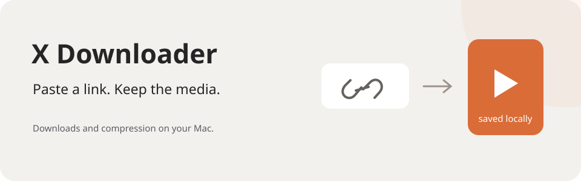

# X Downloader

**Paste a link. Keep the media.**



A native macOS app for downloading media from X/Twitter and Reddit.
You can also compress local images and videos to a target size.

[**Download for macOS →**](https://github.com/nickdrezza/x-video-downloader/releases/latest)

## Two jobs. One small app.

| Mode | Use it to |
| --- | --- |
| Download + compress | Save media from X/Twitter, Reddit, or `redd.it` links. |
| Compress only | Select or drop local images and videos. |

Set a maximum size in MB or KB, or leave it empty to keep the input file.
The app accepts multiple files, finds supported URLs in pasted text, removes duplicate URLs,
and never overwrites an existing file.

## Install

Requires macOS 13 or later. Install these three tools first:

```sh
brew install yt-dlp gallery-dl ffmpeg
```

1. Log into the source site in a supported browser.
2. Download the DMG from [Releases](https://github.com/nickdrezza/x-video-downloader/releases/latest).
3. Open it and drag **X Downloader.app** into Applications. A ZIP is also available.
4. Open the app and choose the browser in **X Downloader → Browser Cookies**.
5. Follow **Permissions Setup** if the download tools need access to that browser's cookie store.

The setup screen opens **System Settings → Privacy & Security → Full Disk Access**.
Add X Downloader there, then relaunch it. The screen is also available from the app menu.
Supported browsers include Safari, Chrome, Firefox, Edge, Brave, Chromium, Opera, and Vivaldi.

The release is ad hoc signed and not notarized. macOS can block a downloaded copy.
You can build from source instead.

## Files and size limits

- Images become JPEG. The app reduces quality first, then dimensions if needed.
  Transparency is flattened onto white.
- Videos become H.264/AAC MP4. The app plans the bitrate and adjusts dimensions or frame rate
  when needed. Compressed videos have no media metadata or chapters.
- Size limits use decimal units: `20 MB` means `20,000,000 bytes`.
- An empty limit keeps the downloaded or selected file without compression.

<details>
<summary>How downloads and browser cookies work</summary>

`gallery-dl` downloads image attachments. `yt-dlp` downloads video attachments.
Both use `--cookies-from-browser` with the browser you selected.
FFmpeg merges separate video and audio streams when needed and handles local compression.

The app does not store your credentials or cookies. The tools read the local browser cookie
store when a download starts. Your account must already have access to the media.
Deleted, protected, age-restricted, region-restricted, and login-only posts can still fail.
Processing runs on your Mac. No API key or paid service is required.

</details>

## Build from source

Install Xcode Command Line Tools on macOS 13 or later.

```sh
git clone https://github.com/nickdrezza/x-video-downloader.git
cd x-video-downloader
./scripts/build.sh
open ".build/X Downloader.app"
```

The script builds for the current Mac architecture, creates the icon and bundle, and signs it
locally. To create ZIP and DMG installers:

```sh
./scripts/package.sh
```

The DMG includes an Applications shortcut.

## Responsible use

Only download media you have permission to save. You are responsible for complying with
copyright law, the source platform's terms, and applicable local rules.

## License

This project is licensed under [GNU AGPLv3 only](LICENSE) (`AGPL-3.0-only`).
See [NOTICE](NOTICE) for copyright information.

You can use, change, and sell copies under the license terms.
If you distribute covered code, provide its source under the same license.
If you change the project and let users access it over a network,
offer those users the source of your version.

Earlier releases keep the license terms that applied to them.
